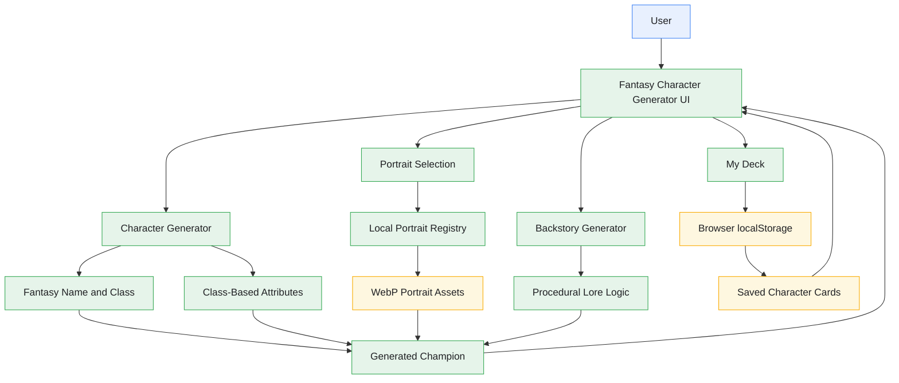

# 🧙 Fantasy Character Generator ⚔️


> 🎮 Explore **Fantasy Character Generator** in action! ✨

> [!NOTE]
> Fantasy Character Generator is a React-based fantasy character creation application deployed on Vercel. It generates champions across six fantasy classes, provides local portrait variants, creates procedural character backstories, and allows users to save and manage characters in a personal browser-based deck.

---

## Table of Contents

- [Introduction](#introduction)
- [Architecture Diagram](#architecture-diagram)
- [Project Structure](#project-structure)
- [Features](#features)
- [Tech Stack](#tech-stack)
- [Application Workflow](#application-workflow)
- [Screenshots](#screenshots)
- [Character Generation Behavior and Capabilities](#character-generation-behavior-and-capabilities)
- [AI-Assisted Development](#ai-assisted-development)
- [Google Skills Challenge Lab Reference](#google-skills-challenge-lab-reference)
- [Future Enhancements](#future-enhancements)
- [Resources](#resources)
- [Disclaimer](#disclaimer)
- [Contributing](#contributing)
- [License](#license)
- [Author](#author)

---

## Introduction

**Fantasy Character Generator** is an interactive fantasy character creation application developed as part of my hands-on learning with Google's AI development tools.

The project explores how to build an engaging web application using React, TypeScript, Vite, and Tailwind CSS. It combines procedural character generation, class-based attributes, curated local portrait assets, fantasy-inspired backstories, and browser-based storage in a single interactive experience.

The application supports six fantasy character classes: Mage, Rogue, Warrior, Ranger, Paladin, and Necromancer. Each generated champion receives a fantasy name, class, attribute values, portrait, and descriptive identity. Users can generate origin chronicles, switch between portrait variants, and preserve their favorite characters in a personal collection called **My Deck**.

The application also explores frontend development concepts, including component-based architecture, state management, browser storage, responsive layouts, visual styling, and production deployment.

Character backstories are generated using local procedural logic rather than a live Gemini API call. Portraits are served from local project assets, allowing the current application to operate without an external image-generation service.

This repository documents my implementation and learning, including the application structure, supporting assets, development workflow, deployment configuration, and related Google Skills learning resources.

---

## Architecture Diagram

The following diagram illustrates a **conceptual view** of the application's main components and their relationships. It shows how users interact with the character-generation interface, portrait assets, attribute and backstory generation, and local deck storage.



> [!NOTE]
> This diagram is a conceptual overview of the application's components, not a verified runtime execution trace. The exact implementation details, state transitions, and interactions should be confirmed against the source code.

### Architecture Overview

1. **Fantasy Character Generator UI**
   - Provides the primary interface for creating and exploring champions.
   - Displays character information, portraits, attributes, and origin chronicles.
   - Allows users to interact with character-generation and deck-management controls.

2. **Character Generator**
   - Provides the character-creation functionality.
   - Generates fantasy character identities and assigns character classes.
   - Coordinates the display of generated character attributes.

3. **Fantasy Name and Class**
   - Represents the identity and vocation assigned to a generated champion.
   - Supports six fantasy classes with distinct visual identities and descriptions.

4. **Class-Based Attributes**
   - Provides Health (HP), Mana (MP), and Strength (STR) values.
   - Uses vocation-based attribute generation to support different character archetypes.

5. **Portrait Selection**
   - Uses the local portrait registry to select the artwork associated with a character class.
   - Supports switching between available portrait variants.

6. **Local Portrait Assets**
   - Stores character artwork under `public/portraits/`.
   - Provides the image files used by the application without requiring a live image-generation API.

7. **Procedural Backstory Generator**
   - Creates fantasy origin chronicles using local procedural logic.
   - Generates narrative text based on fantasy-themed character and world concepts.

8. **My Deck**
   - Provides the interface for saving, finding, inspecting, and managing champions.
   - Uses browser `localStorage` for character persistence.

9. **Browser Storage**
   - Stores saved character data in the user's browser.
   - Does not automatically synchronize saved characters across devices or browsers.

---

## Project Structure

The repository organizes the frontend application, supporting assets, and configuration files into a React and TypeScript project.

```text
fantasy-character-generator/
├── public/
│   └── portraits/
│       ├── mage/
│       ├── rogue/
│       ├── warrior/
│       ├── ranger/
│       ├── paladin/
│       └── necromancer/
│
├── src/
│   ├── App.tsx
│   └── ...
│
├── .env.example
├── .gitignore
├── index.html
├── package.json
├── package-lock.json
├── README.md
├── tsconfig.json
└── vite.config.ts
```

> [!NOTE]
> This tree represents the main application files and directories. Additional components, stylesheets, configuration files, and supporting modules may exist in the repository. Refer to the actual repository for the complete structure.

### Key Components

- **`src/`** — Contains the main React application source code and supporting modules.
- **`src/App.tsx`** — Contains the main application implementation and character-related interface logic.
- **`public/portraits/`** — Contains locally stored character portrait assets organized by class.
- **`public/portraits/mage/`** — Contains portrait assets for Mage characters.
- **`public/portraits/rogue/`** — Contains portrait assets for Rogue characters.
- **`public/portraits/warrior/`** — Contains portrait assets for Warrior characters.
- **`public/portraits/ranger/`** — Contains portrait assets for Ranger characters.
- **`public/portraits/paladin/`** — Contains portrait assets for Paladin characters.
- **`public/portraits/necromancer/`** — Contains portrait assets for Necromancer characters.
- **`package.json`** — Defines the project's npm scripts and dependencies.
- **`package-lock.json`** — Records the resolved npm dependency tree.
- **`vite.config.ts`** — Contains the Vite build and development-server configuration.
- **`tsconfig.json`** — Contains TypeScript compiler configuration.
- **`.gitignore`** — Excludes configured local, generated, and sensitive files from version control.
- **`.env.example`** — Provides an example environment-variable file, where applicable.

---

## Features

- **Six Fantasy Character Classes:** Generate champions belonging to Mage, Rogue, Warrior, Ranger, Paladin, and Necromancer classes.
- **Random Character Generation:** Create fantasy champions with generated names, titles, attributes, and class identities.
- **Class-Based Attribute Generation:** Generate Health (HP), Mana (MP), and Strength (STR) values tailored to different character archetypes.
- **Curated Portrait Collection:** Display local character artwork organized by class.
- **Portrait Regeneration:** Switch between available portrait variants without regenerating the entire character.
- **Procedural Backstory Generation:** Generate fantasy origin chronicles using local procedural logic.
- **My Deck:** Save and manage generated champions in a personal character collection.
- **Browser-Based Persistence:** Store saved character data using browser `localStorage`.
- **Character Search:** Find saved champions by name.
- **Class Filtering:** Filter the deck by character class.
- **Sorting Options:** Organize saved characters using supported sorting options, including recency and character attributes.
- **Character Inspection:** Load a saved champion back into the main workbench.
- **Chronicle Reading:** Read the saved backstory associated with a character.
- **Safe Deletion:** Delete saved characters with an undo option.
- **Duplicate Prevention:** Avoid repeatedly saving identical champions where the implemented duplicate checks apply.
- **Responsive Interface:** Present the character-generation experience across supported screen sizes.
- **Fantasy-Inspired Visual Design:** Use antique gold accents, dark textured backgrounds, decorative frames, and fantasy typography.
- **Local Asset Delivery:** Serve portraits directly from the application instead of generating images through an external API at runtime.
- **Vercel Deployment:** Host the frontend application using Vercel's static build and deployment workflow.

> [!NOTE]
> The application's behavior depends on the current source code, browser capabilities, local assets, and configuration. Saved characters remain local to the browser unless synchronization is explicitly implemented in a future version.

---

## Tech Stack

| Technology | Purpose |
|---|---|
| **React 19** | Component-based frontend user interface |
| **TypeScript** | Typed application development |
| **Vite** | Development server and production build tooling |
| **Tailwind CSS v4** | Utility-first styling and interface design |
| **Lucide React** | Icons and interface symbols |
| **Google Fonts** | Fantasy-inspired typography |
| **WebP Images** | Optimized local character portrait assets |
| **JavaScript Web APIs** | Browser functionality and local data persistence |
| **`localStorage`** | Client-side storage for saved character cards |
| **Git** | Version control |
| **GitHub** | Source code hosting and project documentation |
| **Vercel** | Frontend deployment and hosting |
| **Google AI Studio** | AI-assisted application development and prototyping |

> [!NOTE]
> The table describes the technology stack based on the project's supplied technical reference. Confirm exact dependency versions in `package.json` and the lockfile if version-specific details are required. The current implementation does not require a Gemini API key for its procedural backstory generation or local portrait delivery.

---

## Application Workflow

**Fantasy Character Generator** provides an interactive workbench for creating champions and preserving them in a personal grimoire. The workflow combines character generation, local portrait selection, attribute display, procedural backstories, and browser-based storage.

### 1️⃣ Character Generation

- Open the Fantasy Character Generator application.
- Select a specific class or use the option to generate a character from any class.
- Generate a random champion.
- Review the generated character's name, title, class, and attributes.

### 2️⃣ Class-Based Attribute Assignment

- The generated champion receives Health (HP), Mana (MP), and Strength (STR) values.
- Attribute generation is tailored to the selected character vocation.
- The interface displays the generated values using attribute indicators.

### 3️⃣ Portrait Selection

- The application selects a local portrait associated with the character's class.
- Portrait artwork is loaded from the `public/portraits/` directory.
- Use **Regenerate Portrait** to switch between available portrait variants.
- Portrait regeneration preserves the character's other information.

### 4️⃣ Procedural Backstory Generation

- Select **Generate Backstory** to create an origin chronicle.
- The application uses local procedural logic to generate fantasy-themed narrative text.
- Review the resulting character history in the Origin Chronicle section.

### 5️⃣ Save to My Deck

- Save a generated champion to the personal deck.
- The application stores saved character information in browser `localStorage`.
- Saved cards remain available in the same browser profile while the stored data remains intact.

### 6️⃣ Search and Manage Saved Champions

- Search for saved characters by name.
- Filter saved champions by class.
- Sort the deck using the available sorting options.
- Inspect a saved character to load it back into the main workbench.
- Read saved chronicles and use the supported deletion and undo controls.

### 7️⃣ Development and Deployment

- Make changes to the React and TypeScript source code.
- Run the available validation and production-build commands.
- Review the production build before publishing changes.
- Push approved updates to the connected GitHub repository.
- Use Vercel to build and deploy the updated frontend application.

> [!IMPORTANT]
> Saved characters are stored locally in the browser. They are not automatically shared between devices, browser profiles, or users.

---

## Screenshots

This section showcases the **Fantasy Character Generator** interface, character creation experience, and personal deck.

### Main Workbench

The main workbench provides the character-generation controls, class filters, and generated champion card.


### Generated Character

The generated character view displays the champion's portrait, name, title, class, attributes, and origin chronicle.


### My Deck

The personal deck displays saved champions and provides controls for searching, filtering, sorting, and inspecting saved characters.


> [!NOTE]
> The screenshot paths above are placeholders. Upload the corresponding screenshots to a `docs/screenshots/` directory in the repository, or replace these paths with the actual GitHub-hosted image URLs before publishing this section.

---

## Character Generation Behavior and Capabilities

### Fantasy Character Classes

The application supports six fantasy character classes, each with its own identity and portrait collection.

#### Mage

The Mage represents an arcane spellcaster associated with celestial energies, elemental magic, and ancient mysteries.

Areas to explore include:

- Mage-specific character generation.
- Portrait selection and regeneration.
- Generated Health, Mana, and Strength attributes.
- Procedural origin chronicles.

#### Rogue

The Rogue represents a stealth-oriented character associated with agility, deception, and precision.

Areas to explore include:

- Rogue character generation.
- Class-specific portrait assets.
- Attribute assignment.
- Character identity and backstory generation.

#### Warrior

The Warrior represents a battle-hardened fighter associated with strength, resilience, and martial combat.

Areas to explore include:

- Warrior character generation.
- Portrait variants.
- Class-based attributes.
- Character titles and procedural chronicles.

#### Ranger

The Ranger represents a wilderness-oriented character associated with tracking, ranged combat, and exploration.

Areas to explore include:

- Ranger character generation.
- Portrait selection.
- Attribute generation.
- Fantasy-themed character backstories.

#### Paladin

The Paladin represents a sacred champion associated with protection, righteousness, and radiant power.

Areas to explore include:

- Paladin character generation.
- Portrait variants.
- Character attributes.
- Procedural origin chronicles.

#### Necromancer

The Necromancer represents a dark spellcaster associated with forbidden rituals and the mysteries of the dead.

Areas to explore include:

- Necromancer character generation.
- Portrait selection.
- Class-based attribute assignment.
- Character identity and narrative generation.

### Local Portrait Engine

The `public/portraits/` directory contains the artwork used by the application.

Areas to explore include:

- Portrait organization by character class.
- Local WebP image delivery.
- Portrait registry configuration.
- Switching between portrait variants.
- Handling of unavailable or incorrectly referenced assets.

The current application uses local image assets rather than requiring an external image-generation service at runtime.

### Procedural Origin Chronicles

The origin chronicle functionality creates fantasy-themed backstories using local procedural logic.

Areas to explore include:

- Character backstory generation.
- Fantasy narrative templates and descriptions.
- Presentation of generated chronicles.
- Preservation of character information while generating narrative text.
- Reading chronicles associated with saved characters.

The current implementation does not depend on a live Gemini API call to generate these backstories.

### My Deck and Browser Storage

The personal deck allows users to preserve and manage generated champions.

Areas to explore include:

- Saving generated characters.
- Browser `localStorage` persistence.
- Searching by character name.
- Filtering by class.
- Sorting saved cards.
- Inspecting previously saved champions.
- Reading character chronicles.
- Deleting cards and using the supported undo behavior.
- Handling browser storage limitations.

Because the deck uses local browser storage, its contents are not automatically synchronized across devices.

---

## AI-Assisted Development

AI-assisted development can support the creation of frontend applications by helping developers explore unfamiliar technologies, understand code, investigate implementation issues, and improve documentation.

During the development and learning process for **Fantasy Character Generator**, AI assistance can support activities such as:

- Exploring React and TypeScript application structure.
- Understanding Vite configuration and production builds.
- Refining the fantasy-inspired interface and component styling.
- Organizing local portrait assets and character classes.
- Reviewing character-generation and procedural backstory logic.
- Investigating browser storage and saved-character behavior.
- Improving accessibility, responsiveness, and error handling.
- Preparing project documentation and deployment instructions.
- Reviewing build errors and troubleshooting deployment issues.

Google AI Studio can be used as part of the prototyping and AI-assisted development workflow, while Visual Studio Code and GitHub support local development, source-code management, and repository maintenance.

AI-generated suggestions and code should be reviewed critically, verified against the actual implementation, and tested before being adopted. AI assistance supports the development process but does not replace independent validation of application behavior, dependencies, security, or deployment configuration.

---

## Google Skills Challenge Lab Reference

This project is associated with the following Google Skills learning resources.

### Course

**Develop AI-Powered Prototypes in Google AI Studio**

[Open the Google Skills course](https://www.skills.google/course_templates/1426)

### Challenge Lab

**Develop AI-Powered Prototypes in Google AI Studio: Challenge Lab**

[Open the Google Skills lab](https://www.skills.google/course_templates/1426/labs/647532)

### Learning Context

The repository serves as a personal project associated with this learning experience.

It provides an opportunity to explore and document:

- Frontend application development.
- React and TypeScript.
- Vite-based development and production builds.
- Tailwind CSS styling.
- Interactive character generation.
- Local asset management.
- Procedural content generation.
- Browser-based persistence.
- GitHub version control.
- Vercel deployment.
- AI-assisted development and prototyping.

For the official learning objectives, instructions, and environment-specific requirements, refer to the Google Skills course and lab pages linked above.

---

## Future Enhancements

The following ideas could be considered for future versions of Fantasy Character Generator:

- **Additional Character Classes:** Expand the application with more fantasy vocations and associated attributes.
- **Expanded Portrait Collections:** Add more artwork variants for each existing class.
- **Character Customization:** Allow users to customize names, titles, attributes, and other character details.
- **Enhanced Backstory Generation:** Introduce additional narrative templates and more varied origin chronicles.
- **Character Export:** Provide options to export character cards as images or structured data.
- **Deck Import and Export:** Allow users to back up and restore their saved characters.
- **Cloud Synchronization:** Explore optional account-based storage for users who want to access saved characters across devices.
- **Accessibility Improvements:** Continue refining keyboard navigation, focus states, screen-reader announcements, and color contrast.
- **Responsive Design Improvements:** Test the interface across a broader range of mobile, tablet, and desktop screen sizes.
- **Portrait Error Handling:** Improve feedback when portrait assets are missing or cannot be loaded.
- **Automated Testing:** Add repeatable tests for character generation, portrait selection, backstory generation, and deck operations.
- **Performance Optimization:** Review asset sizes, rendering behavior, and production bundle performance.
- **Documentation:** Add more screenshots, usage examples, and implementation notes.
- **Deployment Improvements:** Maintain reliable GitHub-to-Vercel deployment and build validation.

> [!IMPORTANT]
> These are potential improvements, not claims that the features are already implemented. Each enhancement should be evaluated and tested against the existing application before being included in a future release.

---

## Resources

[](https://react.dev/)
[](https://www.typescriptlang.org/docs/)
[](https://vite.dev/guide/)
[](https://tailwindcss.com/docs)
[](https://lucide.dev/)
[](https://git-scm.com/doc)
[](https://docs.github.com/)
[](https://vercel.com/docs)
[](https://aistudio.google.com/)

---

## Disclaimer

This project is intended for educational purposes, experimentation, and personal development.

The application generates fictional fantasy characters, attributes, and narratives. Generated character details are intended for entertainment and creative use.

Saved character data is stored locally in the browser. Users should not assume that this data is backed up, synchronized, or recoverable after browser storage is cleared.

The project is deployed on Vercel, and its availability depends on the hosting platform and the project's deployment configuration.

References to Google Skills, Google AI Studio, React, TypeScript, Vite, Tailwind CSS, and other technologies are included for informational purposes. Their respective names and trademarks belong to their owners.

---

## Contributing

Contributions are welcome! If you would like to improve **Fantasy Character Generator**, fix a bug, enhance an agent, add tests, or improve the documentation, please review the following guidelines:

- [Contributing Guide](./CONTRIBUTING.md)
- [Code of Conduct](./CODE_OF_CONDUCT.md)
- [Security Policy](./SECURITY.md)

Please ensure that contributions are focused, documented, and tested where appropriate. Never include secrets or private configuration in issues, commits, or Pull Requests.

---

## License

This project is licensed under the **Apache License 2.0**.

See the [LICENSE](./LICENSE) file for details.

---

## Author

[**Sahil Sharma**](https://github.com/sahil-me)

Thank you for exploring **Fantasy Character Generator**! If you find the project useful, consider giving the repository a ⭐ to show your support.
